<div align="center">
  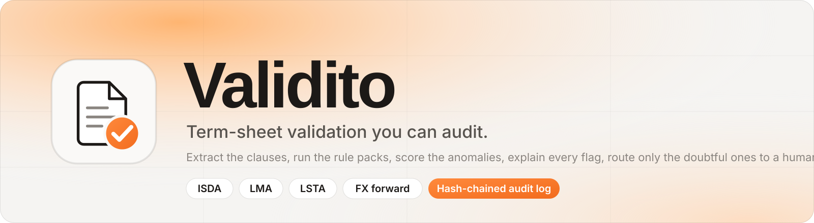

  <br /><br />

  

  <h1>Validito</h1>

  <p><b>Term-sheet validation you can audit.</b></p>

  <p>An AI-assisted validation platform for ISDA, LMA, LSTA and FX term sheets. It extracts the clauses, checks them against versioned rule packs and an anomaly model, explains every flag it raises, routes only the doubtful documents to a human reviewer, and records each decision in a hash-chained audit log.</p>

  <a href="https://validito.vercel.app"></a>
  <a href="https://validito-api.onrender.com/docs"></a>

  <br />

  
  
  
  
  
  <a href="https://github.com/Moukthika6706/Validito/issues"></a>
  
</div>

---

> *"A flag nobody can explain is a flag nobody can trust. Every decision Validito makes names the rule, shows the evidence, and leaves a hash behind."*

## 📌 Overview

**Validito is a term-sheet validation tool that uses AI.** A term sheet is the short document that sums up a financial deal: who the parties are, how much money is involved, the dates, the interest rate, which law applies, and how the deal settles. Before a bank books a trade or a loan, someone has to read that document carefully and catch anything wrong or unusual. Today that is slow, manual work, and mistakes are expensive.

Validito does the first read for you. It pulls the key terms out of the document, checks them against the standard conventions for that market, spots combinations that look unusual, explains every problem it finds in plain words, and only asks a human to look at the documents that need judgement. Every step it takes is written to a tamper-proof log, so anyone can later see exactly what was checked and why a decision was made.

It was first built for a **Barclays hackathon**, then refined into a tool that **financial advisors and deal teams** can use day to day: fewer documents to read by hand, nothing approved without a reason, and a full record behind every decision.

**How it works, step by step.** An analyst uploads a term sheet (PDF, DOCX or a scanned image). Validito:

1. **extracts** the clauses: PyMuPDF for the text layer, EasyOCR for scans, a label-driven extractor plus spaCy NER for 26 fields, each value normalised and given a confidence
2. **validates** them against the market's **rule pack** (ISDA, LMA, LSTA or FX forward, auto-detected), against a linked document (term sheet vs confirmation, original vs amendment), and against an **Isolation Forest** that scores the overall combination of terms
3. **explains** every flag: the rule that fired, the evidence, a frozen snapshot of the rule, and a confidence
4. **routes** the document: auto-approved, or into the review queue where a reviewer accepts, rejects or overrides each flag against the original page
5. **audits** everything in an append-only log whose hashes chain together, so tampering is detectable and any document's history can be replayed

It is built for three kinds of user: **analysts** who upload and track their documents, **reviewers** who clear the queue, and **admins** who manage rule packs and users.

> **All sample documents, counterparties and amounts are synthetic.** The rule packs encode common market conventions for a demo and are not legal or regulatory advice.

**Try it:** [validito.vercel.app](https://validito.vercel.app) · [API docs](https://validito-api.onrender.com/docs)

| Account | Password | Role |
| --- | --- | --- |
| `admin@validito.demo` | `Validito123!` | admin: everything, plus rule packs and users |
| `reviewer@validito.demo` | `Validito123!` | reviewer: review queue and all documents |
| `analyst@validito.demo` | `Validito123!` | analyst: upload and track own documents |

> The API runs on Render's free plan, which sleeps after 15 idle minutes, so the first request after a pause can take 30–60 seconds. The free image has no OCR, so upload the PDF and DOCX samples from [`samples/`](samples/); scanned images need the full Docker image.

---

## 📸 Project Preview

<p align="center">
  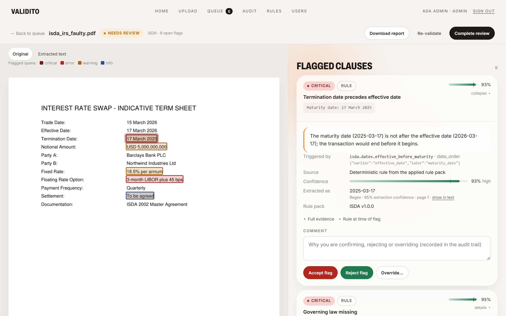
</p>

| Dashboard | Review queue |
| --- | --- |
| 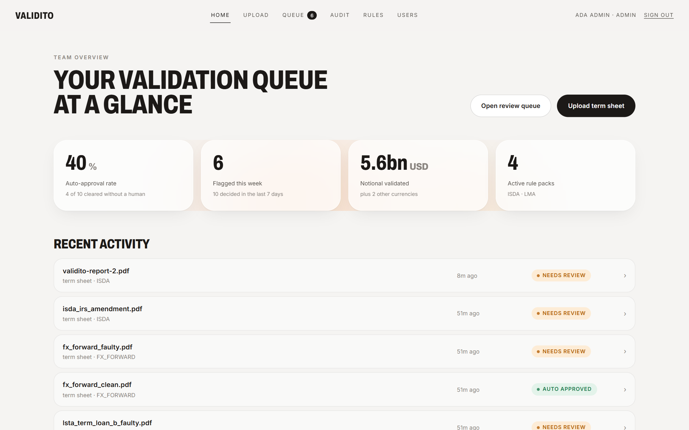 | 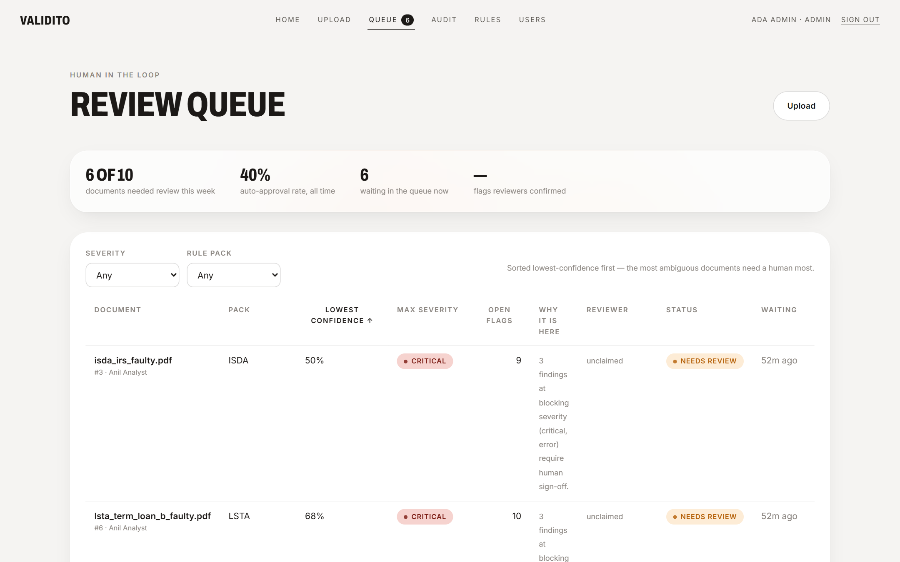 |
| **Upload (single or batch, amendment and cross-document links)** | **Audit trail (append-only, hash-chained)** |
| 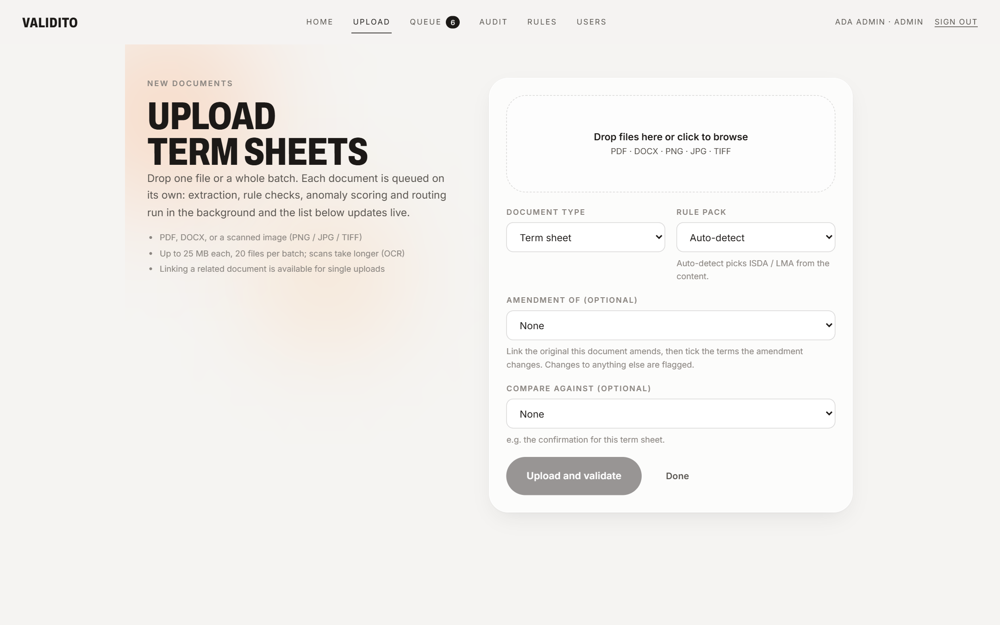 | 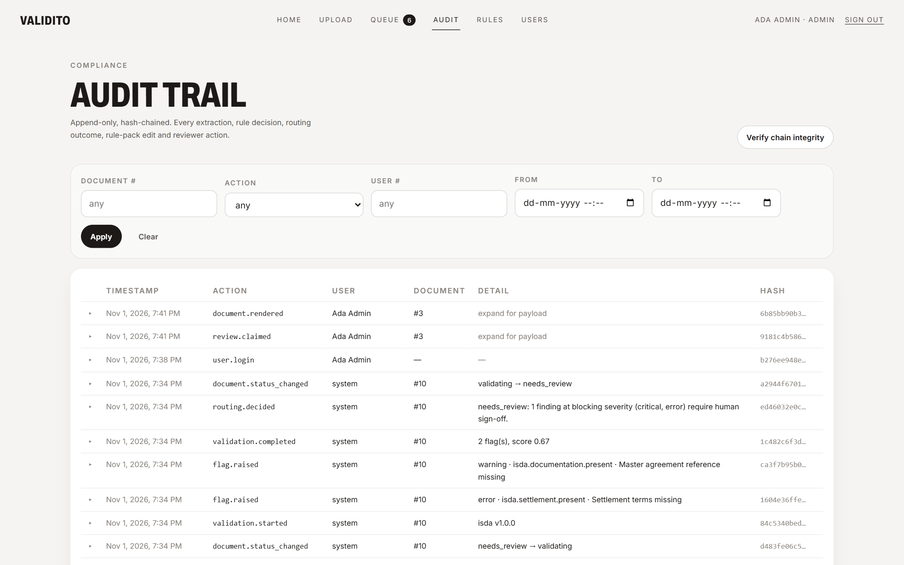 |
| **Rule pack admin (versioned, editable)** | **Amendment review** |
| 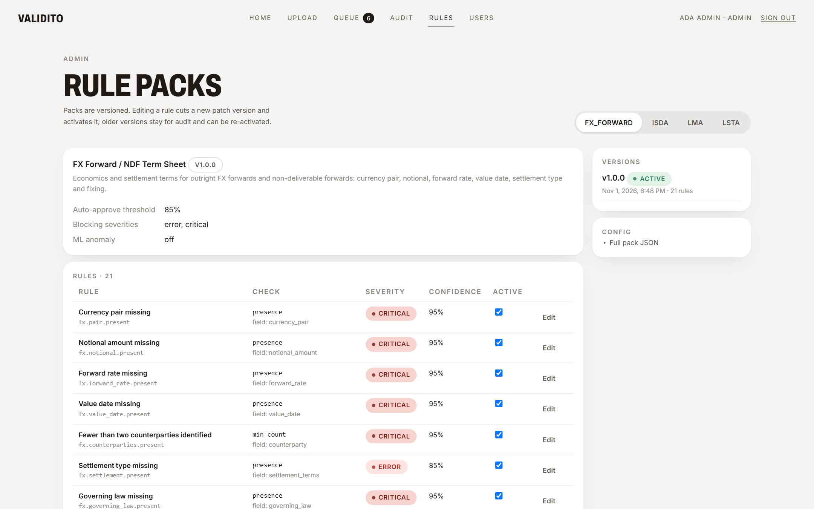 | 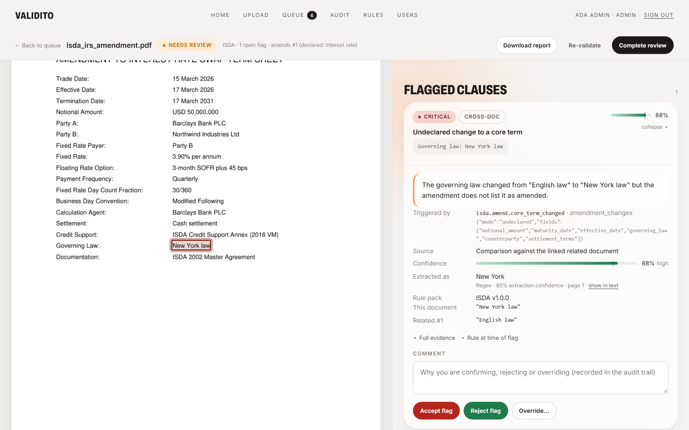 |

<details>
<summary><b>Sign-in and user admin</b></summary>
<br />

| Sign in | Users (admin) |
| --- | --- |
| 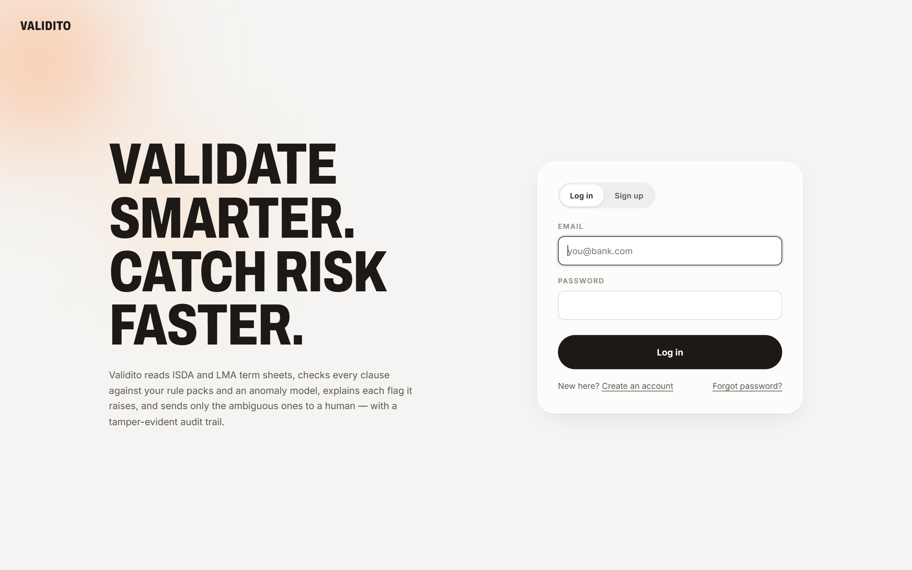 | 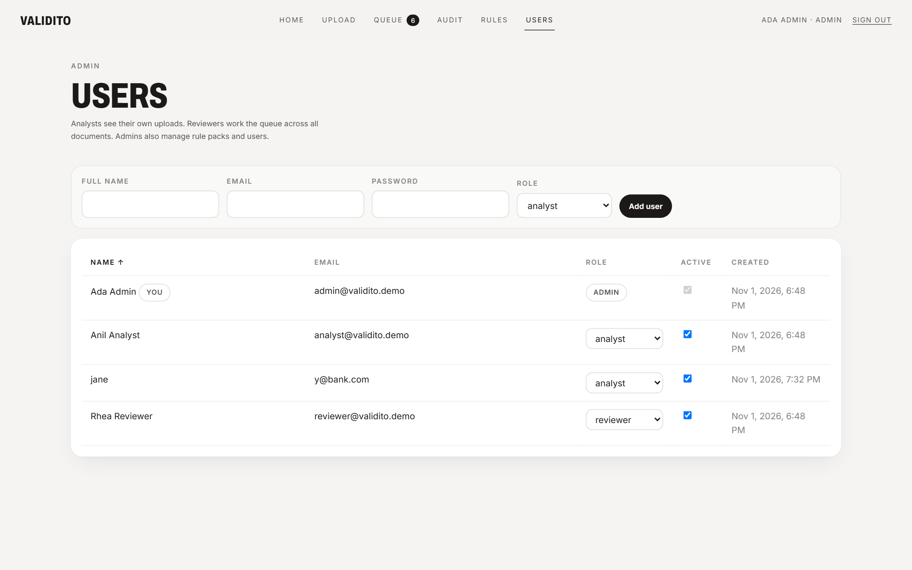 |
</details>

---

## ✨ Features

All features below are implemented and working, locally and in the live demo (OCR excepted on the free tier).

- **Ingestion that scales.** Single or batch upload (20 files), MIME sniffed from content, size and extension checks, content-addressed storage. The API answers `202` at once and Celery workers move each document through `queued → extracting → extracted → validating → auto_approved | needs_review`, retrying transient failures with backoff and recording the failing stage if they give up. The UI polls one status endpoint until every file is terminal.
- **Extraction with provenance.** PyMuPDF text layer, EasyOCR for pages without one, a label-driven extractor for 26 fields (notional, dates, parties, rates, governing law, settlement, day count, currency pair, fixing date …) with normalisers (`USD 50,000,000` → `{amount: 5e7, currency: USD}`, `3-month SOFR + 45 bps` → `{benchmark: SOFR, spread_bps: 45}`), a spaCy NER fallback, and a **bounding box per entity** so the review screen can outline the clause on the original page.
- **Four YAML rule packs, 20 check types.** ISDA (derivatives), LMA (UK/EU loans), LSTA (US loans) and FX forward / NDF. A rule is a few lines of YAML naming a check (`presence`, `range`, `date_order`, `forbidden_values`, `cross_doc_equal`, `role_conflict`, `amendment_changes`, `relative_difference`, `conditional_presence`, `value_in_other` …). A new market is a new YAML file; a new kind of check is one registered Python function. Packs are versioned: editing a rule in the admin UI cuts a new version, and old flags keep the snapshot that raised them.
- **Cross-document and amendment checks.** Link a term sheet to its confirmation and the engine compares them field by field. Upload a document as an amendment, declare which fields change, and any *undeclared* change to a core term is flagged critical.
- **ML anomaly detection.** An Isolation Forest per pack scores the whole combination of terms. Its flags list the top deviating features with z-scores ("fixed rate 18.5% vs typical 3.6%, 8.3σ above"), so the model is never a black box.
- **Explainability by design.** Every flag stores which rule or feature fired, a rendered explanation, the evidence values, the rule snapshot and a confidence = rule certainty × extraction quality × reviewer-feedback calibration. Rules that reviewers keep rejecting lose confidence and drift into the "ask a human" band.
- **Confidence-based routing.** A pure policy function: blocking severities, or any non-trivial flag below the pack's threshold, send the document to review; otherwise it is auto-approved. The dashboard reports the auto-approval rate and the manual-review reduction.
- **Human review with soft locks.** Reviewers claim a document (a time-limited lock; a second reviewer gets `409`), see the page with each flagged clause outlined by severity, and accept / reject / override with a comment. Completing a review finalises the document.
- **Per-document PDF report.** Metadata, every extracted field, the routing decision, each flag with explanation and confidence, reviewer actions, and the document's audit slice with its hashes re-verified.
- **Hash-chained audit log.** Every upload, extraction, flag, routing decision, rule-pack edit, claim, reviewer action, report and notification is an append-only row whose hash covers the previous one. `GET /audit/verify` recomputes the chain. Concurrent writers are serialised on a chain-head row, so the chain cannot fork.
- **Notifications (opt-in).** Email (SMTP) and Slack webhook when a document is routed to review or a flag reaches a severity threshold, with per-document de-duplication and retries. Off by default.
- **LLM-assisted extraction fallback (opt-in).** With an Anthropic key, Claude is asked only for required fields the extractor missed. A proposal is kept only if it appears verbatim in the document, is stored at low confidence with an **AI-proposed** badge, and always routes the document to a human. Off by default.
- **Roles and security.** JWT with bcrypt passwords; analysts see only their own documents (other ids return 404), reviewers see everything, admins manage packs and users. Self-selected roles at sign-up can be switched off for production.
- **132 automated tests** covering normalisers, extraction, every check type, the rule engine, ML scoring, routing, the pipeline, audit chain concurrency, review claims, reports, notifications, the LLM fallback (with a fake client) and the API.

---

## 🛠️ Tech Stack

| Frontend | Backend | Document AI & ML | Data | Infra & DevOps |
| --- | --- | --- | --- | --- |
| React 18 | Python 3.12 | PyMuPDF (PDF text, page rendering) | PostgreSQL (Render) | Docker + Docker Compose |
| Vite 5 | FastAPI 0.162 + Uvicorn | EasyOCR + CPU PyTorch (full image) | MySQL 8 (Docker Compose) | nginx (static + API proxy) |
| React Router 6 | Pydantic 2 + pydantic-settings | spaCy 3.8 (`en_core_web_sm`) | SQLite (local dev, tests) | Render (API + Postgres) |
| Plain CSS design tokens (Archivo + Inter) | SQLAlchemy 2 + Alembic | scikit-learn IsolationForest, pandas, NumPy | Redis (Celery broker) | Vercel (frontend) |
| | Celery 5 (per-stage queues) | python-docx | hash-chained `audit_log` | AWS EC2 runbook (Compose) |
| | PyJWT + bcrypt | reportlab (PDF reports) | | GitHub |
| | pytest + httpx | Anthropic SDK (optional fallback) | | |

---

## ⚙️ Getting Started

Three ways to run it, from easiest to most hands-on.

### Option A: Docker (full stack with OCR)

```bash
git clone https://github.com/Moukthika6706/Validito.git
cd Validito
docker compose up --build
```

| URL | What |
| --- | --- |
| http://localhost:5173 | React UI |
| http://localhost:5173/docs | Swagger / OpenAPI (proxied to the API) |
| http://localhost:8000/health | API health |

The API container runs migrations, seeds the rule packs, the three demo accounts and the processed sample documents on first boot. The first build downloads CPU PyTorch and the EasyOCR models (about 1 GB) so scanned documents work out of the box. Set `SEED_DEMO_DATA=false` to boot empty.

### Option B: Local, no Docker (SQLite, tasks run inline)

**Prerequisites:** Python 3.12, Node.js 20 or newer, Git.

1. **Fork and clone:**
   ```bash
   git clone https://github.com/<your-username>/Validito.git
   cd Validito
   git remote add upstream https://github.com/Moukthika6706/Validito.git
   ```

2. **Backend:**
   ```bash
   cd backend
   python -m venv .venv
   # Windows (PowerShell): .venv\Scripts\Activate.ps1   |   macOS / Linux: source .venv/bin/activate
   pip install -r requirements.txt
   python -m spacy download en_core_web_sm
   ```
   Create `backend/.env` with the no-infrastructure settings:
   ```
   DATABASE_URL=sqlite:///./dev.db
   CELERY_TASK_ALWAYS_EAGER=true
   SECRET_KEY=any-long-random-string
   ```
   Then create the schema, the demo data and start the API:
   ```bash
   python scripts/make_samples.py                     # demo term sheets into ../samples
   python scripts/seed.py --create-schema --samples   # users, rule packs, processed samples
   uvicorn app.main:app --reload --port 8000          # http://localhost:8000/docs
   ```
   Scanned-image uploads additionally need `pip install -r requirements-ocr.txt` (pulls PyTorch).

3. **Frontend** (second terminal, from the repository root):
   ```bash
   cd frontend
   npm install
   npm run dev          # http://localhost:5173, proxies /api to :8000
   ```

4. **Tests** (from `backend/`, with the virtual environment active):
   ```bash
   python -m pytest -q
   ```

### Option C: Production-style (MySQL + Redis + Celery workers)

Copy [`.env.example`](.env.example) to `backend/.env`, point `MYSQL_*` and `REDIS_URL` at your services, run `alembic upgrade head`, then start `uvicorn` and a worker:

```bash
celery -A app.workers.celery_app worker -Q extraction,validation,notifications,default --loglevel=info
```

<details>
<summary><b>Environment variables</b></summary>
<br />

Everything has a safe default; see [`.env.example`](.env.example) for the full list.

| Variable | Default | Purpose |
| --- | --- | --- |
| `DATABASE_URL` | built from `MYSQL_*` | `sqlite:///./dev.db`, `mysql+pymysql://…` or `postgresql://…` |
| `CELERY_TASK_ALWAYS_EAGER` | `false` | `true` runs the pipeline inside the API process (no Redis / worker) |
| `STORAGE_BACKEND` | `local` | `db` mirrors uploads into Postgres/MySQL for hosts with an ephemeral disk |
| `SECRET_KEY` | change me | JWT signing key |
| `CORS_ORIGINS` | `http://localhost:5173` | Comma-separated frontend origins |
| `ALLOW_SELF_ROLE_SELECTION` | `true` | Set `false` in production so only admins assign roles |
| `AUTO_APPROVE_CONFIDENCE` | `0.85` | Default routing threshold (rule packs override) |
| `LLM_FALLBACK_ENABLED`, `ANTHROPIC_API_KEY`, `LLM_MODEL` | off | Claude-assisted extraction for missing required fields |
| `NOTIFY_EMAIL_ENABLED`, `NOTIFY_SLACK_ENABLED` + SMTP / webhook settings | off | Review and severity notifications |
| `SEED_DEMO_DATA`, `SEED_SAMPLES` | `true`, `1` | Seed accounts, packs and samples on container start |
</details>

<details>
<summary><b>Troubleshooting</b></summary>

* **"Cannot reach the server" on the sign-in page.** The API is not running, or its `CORS_ORIGINS` does not include the frontend's origin. Locally the Vite dev server proxies `/api`, so only the API needs to be up.
* **Login works but the dashboard is empty.** Seed the demo data: `python scripts/seed.py --samples`.
* **Scanned PNG upload fails.** Install `requirements-ocr.txt` (local) or use the full `backend/Dockerfile`; the lite image used on Render has no OCR.
* **Schema errors after pulling.** Run `alembic upgrade head` (Docker and Render do this on start).
* **`[WinError 206]` during `pip install` on Windows.** Clone into a short path such as `C:\dev\` or enable long paths.
</details>

---

## 🧭 Usage Examples

### In the app
1. **Upload.** Sign in as `analyst@validito.demo`, open **Upload**, drop `samples/isda_irs_faulty.pdf` and leave the rule pack on *Auto-detect*. Watch it move from *queued* to *needs review* in a few seconds.
2. **Review.** Sign in as `reviewer@validito.demo`, open **Queue** (lowest confidence first) and click the document. The original page shows each flagged clause outlined by severity. Click *Termination date precedes effective date*, read the rule, the evidence and the 93% confidence, add a comment and **Accept**. **Complete review** when done.
3. **Compare documents.** Upload `isda_irs_confirmation.pdf` with *Compare against* set to the clean ISDA term sheet. Mismatched fields appear as cross-document flags.
4. **Amend.** Upload `isda_irs_amendment.pdf` with *Amendment of* the clean term sheet and tick only the fields you meant to change. Any other change is flagged critical.
5. **Prove the log.** Open **Audit**, filter by document, expand a row to see its payload and hash, then **Verify chain integrity**.
6. **Tune a pack.** As admin, open **Rules**, switch a rule off or change its severity: a new pack version is cut and the previous one stays for audit.
7. **Export.** On any reviewed document click **Download report** for the PDF.

### API: health check
```bash
curl https://validito-api.onrender.com/health
```
```json
{"status": "ok", "database": true, "env": "production"}
```

### API: log in and upload a term sheet
```bash
TOKEN=$(curl -s -X POST https://validito-api.onrender.com/api/v1/auth/login \
  -d 'username=analyst@validito.demo&password=Validito123!' | python -c "import sys,json;print(json.load(sys.stdin)['access_token'])")

curl -X POST https://validito-api.onrender.com/api/v1/documents \
  -H "Authorization: Bearer $TOKEN" \
  -F "file=@samples/isda_irs_faulty.pdf" -F "doc_type=term_sheet"
```
Response (`202 Accepted`, shortened):
```json
{"id": 11, "original_filename": "isda_irs_faulty.pdf", "status": "queued", "rule_pack_key": null}
```

### API: poll, read the flags, verify the audit chain
```bash
curl -H "Authorization: Bearer $TOKEN" "https://validito-api.onrender.com/api/v1/documents/status?ids=11"
curl -H "Authorization: Bearer $TOKEN"  https://validito-api.onrender.com/api/v1/documents/11/flags
curl -H "Authorization: Bearer $TOKEN"  https://validito-api.onrender.com/api/v1/audit/documents/11
curl -H "Authorization: Bearer $ADMIN_TOKEN" https://validito-api.onrender.com/api/v1/audit/verify
```
A flag, shortened:
```json
{
  "rule_id": "isda.dates.effective_before_maturity",
  "severity": "critical",
  "source": "rule",
  "title": "Termination date precedes effective date",
  "explanation": "The maturity date (2025-03-17) is not after the effective date (2026-03-17); the transaction would end before it begins.",
  "evidence": {"earlier": "2026-03-17", "later": "2025-03-17"},
  "confidence": 0.93,
  "rule_snapshot": {"check": "date_order", "params": {"earlier": "effective_date", "later": "maturity_date"}}
}
```

<details>
<summary><b>All endpoints</b> (under <code>/api/v1</code>, JWT required except register / login)</summary>

| Area | Endpoints |
| --- | --- |
| Auth | `POST /auth/register`, `POST /auth/login`, `GET /auth/me` |
| Documents | `POST /documents` (202), `POST /documents/bulk`, `GET /documents/status?ids=`, `GET /documents`, `GET /documents/{id}`, `/entities`, `/text`, `/file`, `/pages`, `/pages/{n}.png`, `/flags`, `/runs`, `/report.pdf`, `POST /{id}/reprocess`, `POST /{id}/validate`, `PUT /{id}/amendment`, `PUT /{id}/link` |
| Validation | `GET /validation/runs/{id}`, `GET /flags/{id}` |
| Review (reviewer+) | `GET /review/queue`, `POST` / `DELETE /review/documents/{id}/claim`, `POST /review/flags/{id}/actions`, `POST /review/documents/{id}/complete` |
| Audit | `GET /audit`, `GET /audit/documents/{id}`, `GET /audit/event-types`, `GET /audit/verify` (admin) |
| Rule packs | `GET /rule-packs`, `GET /rule-packs/{key}`, `GET /rule-packs/checks`; admin: `POST /rule-packs`, `PATCH /rule-packs/{key}/rules/{rule_id}`, `POST /rule-packs/versions/{id}/activate` |
| Metrics | `GET /metrics/summary` |
| Users (admin) | `GET /users`, `POST /users`, `PATCH /users/{id}` |
</details>

---

## 🏗️ Architecture

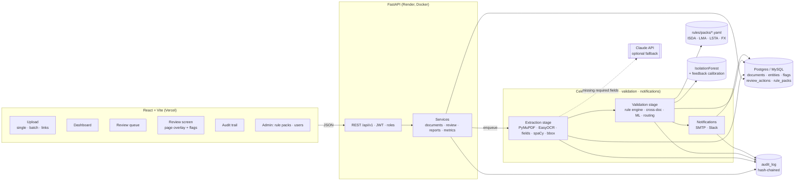

**One document, end to end:**
1. `POST /documents` validates the file, stores it, writes `document.uploaded` to the audit log and returns `202`.
2. The **extraction** task pulls text (or OCRs the page), runs the field specs and NER, normalises values, records bounding boxes and confidences.
3. The **validation** task loads the active pack version, runs every rule plus cross-document and amendment checks, scores the term vector with the Isolation Forest, builds explanations, and applies the routing policy.
4. The document lands in *auto_approved* or *needs_review*; a notification goes out if enabled.
5. A reviewer claims it, acts on each flag, completes the review. Rejections feed the calibration that scales future confidences for that rule.
6. Every step above appended a row to `audit_log`, each hashed over the previous row.

---

## 🧠 Technical Depth

**Why rule packs in YAML rather than code?** Market conventions change more often than software does, and the people who know them are not developers. A pack is data: validated with Pydantic when it loads, versioned on every edit, and snapshotted into each flag so a reviewer six months later sees the rule as it was.

**Why both rules and a model?** Rules catch what someone has already thought of. The Isolation Forest catches the combination nobody wrote a rule for: a plausible rate, a plausible tenor, a plausible notional, together unlike anything the pack has seen. Its output is still explained in the same shape as a rule flag (top features with z-scores), so the review screen does not care which fired.

**Why is confidence a product of three factors?** Rule certainty says how sure the rule author was. Extraction quality says how sure we are of the value it ran on (OCR'd pages score lower). Reviewer-feedback calibration says how often reviewers agree with this rule in practice. A high-certainty rule running on a shaky OCR value that reviewers keep rejecting should not block an approval, and with this formula it does not.

**Why route on confidence instead of severity alone?** Severity is the rule author's opinion of the worst case. Confidence is the system's opinion of this instance. Blocking severities always need a human, but a low-confidence warning does too, because a wrong auto-approval is the failure mode a bank cannot afford. The threshold lives in the pack, so each market tunes its own.

**Why a hash chain and not just timestamps?** A timestamped table can be edited. Each audit row stores the hash of its payload together with the previous row's hash, and writers serialise on a chain-head row (locked with `SELECT … FOR UPDATE`, preceded by a no-op update so SQLite honours it too), so concurrent documents cannot fork the chain. `GET /audit/verify` recomputes it from the first row.

**Why bounding boxes?** "Fixed rate off-market" is more convincing when the reviewer sees the clause outlined on the page they would have read anyway. Entities keep normalised page rectangles, the API renders pages on demand, and the review screen draws the overlay and links each flag to its span (DOCX falls back to highlighting the extracted text).

**Why is the LLM only a fallback, and off by default?** Deterministic extraction is auditable and free. Claude is asked only for required fields the extractor missed, may only return values that appear verbatim in the document, is recorded at a low fixed confidence with an *AI-proposed* badge, and always sends the document to a human. The audit event logs model, field names and latency, never document text.

**Why Celery queues per stage?** Extraction is heavy (OCR, rendering), validation is light. Separate queues let `docker compose up --scale worker=N`, or dedicated GPU workers on `-Q extraction`, scale the expensive stage alone. In development and on the free tier, `CELERY_TASK_ALWAYS_EAGER=true` runs the same code inline.

---

## 📊 Rule packs and samples

| Pack | Rules | Covers | Samples |
| --- | --- | --- | --- |
| ISDA | 35 | Interest-rate swap term sheets: parties, notional, dates, fixed and floating legs, documentation, settlement, governing law; confirmation cross-checks; amendment rules | `isda_irs_clean.pdf`, `isda_irs_faulty.pdf`, `isda_irs_confirmation.pdf`, `isda_irs_amendment.pdf`, `isda_irs_scanned.png` |
| LMA | 32 | UK/EU syndicated loans: facility, margin, agent and lender roles, maturity, repayment, English law | `lma_term_loan_clean.docx` |
| LSTA | 32 | US loans: Term Loan A/B, revolvers, administrative agent, applicable margin, commitment fee, Term SOFR, New York law | `lsta_term_loan_b_clean.pdf`, `lsta_term_loan_b_faulty.pdf` |
| FX forward / NDF | 27 | Currency pair, notional currency in pair, forward vs spot deviation, value date, deliverability, NDF fixing date | `fx_forward_clean.pdf`, `fx_forward_faulty.pdf` |

Rule counts include cross-document and amendment rules. Auto-detection scores each pack's `applies_to` keywords and boosts an explicit mention of the standard. Adding a rule:

```yaml
# backend/app/rules/packs/isda.yaml
- id: isda.spread.range
  check: range                      # any name registered in app/rules/checks
  field: interest_rate
  params: {path: spread_bps, min: -200, max: 1000}
  severity: warning
  confidence: 0.75
  title: Spread off-market
  explanation: A spread of {value} bps is outside the {min} to {max} bps range expected over the benchmark.
```

---

## ⚠️ Limitations

* **The free deployment has no OCR.** Render's free image skips PyTorch and EasyOCR, so scanned images are rejected there with a clear message. The full Docker image handles them.
* **Free-tier persistence.** The API sleeps after 15 idle minutes and the free Postgres expires after 90 days unless upgraded.
* **Anomaly model is trained on the demo book.** With only the seeded documents per pack the Isolation Forest has little to learn from; it becomes useful as real volume accrues.
* **Extraction is label-driven.** Term sheets that abandon the "Label: Value" layout rely on NER and (if enabled) the LLM fallback, with lower confidence.
* **Accessibility gaps.** Keyboard focus styles and reduced-motion support in the frontend are incomplete, and the phone layout needs work.
* **No password reset flow** behind the sign-in link; admins reset passwords through the users API.

## 🔭 Future Improvements

* A trained anomaly model per pack on a larger corpus, with drift monitoring
* Layout-aware extraction (table and column detection) for non-standard term sheets
* Rule-pack diffing and approval workflow (propose, review, activate) with effective dates
* Webhooks and an SSO option for enterprise deployment
* Accessibility pass (focus, reduced motion, phone layout) and dark mode
* Export of the audit chain to external WORM storage

---

## 📁 Repository Structure

```
Validito/
├── backend/
│   ├── app/
│   │   ├── api/v1/          # auth, documents, validation, review, audit, rule_packs, metrics, users
│   │   ├── services/        # business logic shared by routers and workers
│   │   ├── ingestion/       # upload validation, MIME sniffing, content-addressed storage
│   │   ├── extraction/      # text, OCR, 26 field specs, normalisers, NER, provenance, LLM fallback
│   │   ├── rules/           # schema, loader, engine, checks/, packs/{isda,lma,lsta,fx_forward}.yaml
│   │   ├── ml/              # features, IsolationForest, reviewer-feedback calibration
│   │   ├── validation/      # orchestrator and routing policy
│   │   ├── explainability/  # confidence bands, source descriptions, summaries
│   │   ├── audit/           # hash-chained logger and verifier, event types
│   │   ├── notifications/   # SMTP and Slack channels
│   │   ├── workers/         # Celery app and per-stage tasks
│   │   └── models/          # SQLAlchemy ORM
│   ├── alembic/             # migrations
│   ├── scripts/             # seed.py, make_samples.py
│   ├── tests/               # 132 pytest tests
│   ├── Dockerfile           # full image (OCR)
│   ├── Dockerfile.lite      # Render image (no OCR)
│   └── requirements*.txt
├── frontend/
│   └── src/
│       ├── pages/           # Auth, Dashboard, UploadDocument, ReviewQueue, ReviewDocument, AuditTrail, AdminRulePacks, AdminUsers
│       ├── components/      # Button, StatCard, StatusPill, ConfidenceMeter, ClauseCard, DataTable, PageViewer, GlowBackground, States
│       ├── api/             # client + endpoints
│       └── theme/tokens.css # design tokens
├── samples/                 # synthetic term sheets used by the seed and the demo
├── docs/                    # ARCHITECTURE.md, DATA_MODEL.md, logo, banner, screenshots
├── deploy/
│   ├── render-vercel/       # free-hosting runbook
│   └── aws/                 # EC2 user-data script and runbook
├── docker-compose.yml       # mysql, redis, api, worker, frontend (nginx)
├── docker-compose.prod.yml  # production overlay
├── render.yaml              # Render blueprint
└── .env.example
```

See [docs/ARCHITECTURE.md](docs/ARCHITECTURE.md) and [docs/DATA_MODEL.md](docs/DATA_MODEL.md) for the module map and the schema.

---

## 🚀 Deployment

| Target | How | Notes |
| --- | --- | --- |
| **Render + Vercel** (the live demo) | [deploy/render-vercel/RUNBOOK.md](deploy/render-vercel/RUNBOOK.md) | Free. `render.yaml` creates the API (lite image) and Postgres; Vercel builds `frontend/` with `VITE_API_URL`; set `CORS_ORIGINS` and `FRONTEND_BASE_URL` on Render to the Vercel URL. |
| **AWS EC2** | [deploy/aws/RUNBOOK.md](deploy/aws/RUNBOOK.md) | One instance runs the full stack (OCR included) with `docker compose -f docker-compose.yml -f docker-compose.prod.yml up -d --build`. |
| **Any Docker host** | `docker compose up --build` | MySQL, Redis, API, worker and nginx frontend. |

Pushing to `main` redeploys both halves of the live demo automatically.

---

## 🤝 Contributing

Contributions are welcome. To keep the repository tidy:

* **Open or claim an issue first** and wait to be assigned before writing code.
* **Create a branch.** Never push directly to `main`:
  ```bash
  git checkout -b feat/short-description
  ```
* **Keep pull requests focused** on the assigned issue, without formatting noise.
* **Run the checks before you push:** `python -m pytest -q` in `backend/`, and `npm run build` in `frontend/`.
* **Respect the design ideas.** Market conventions belong in YAML, not Python; every new action writes an audit event; external services stay off by default and fail without breaking a document; the AI proposes, people decide.

---

## 👑 Project Maintainers

| Name | Role | GitHub | Contact |
| --- | --- | --- | --- |
| **Moukthika** | Project Admin | [@Moukthika6706](https://github.com/Moukthika6706) | [GitHub Issues](https://github.com/Moukthika6706/Validito/issues) |

## ✨ Contributors

<a href="https://github.com/Moukthika6706/Validito/graphs/contributors">
  
</a>

---

## 📄 License

No open-source license has been chosen yet, so all rights are reserved by the author. Please open an issue if you'd like to reuse the code.
